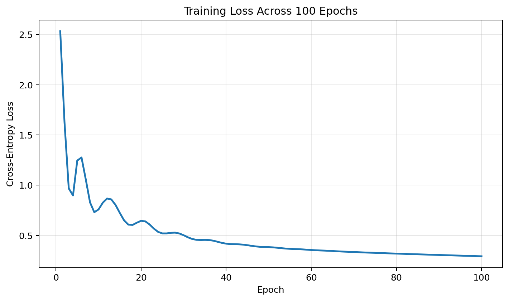
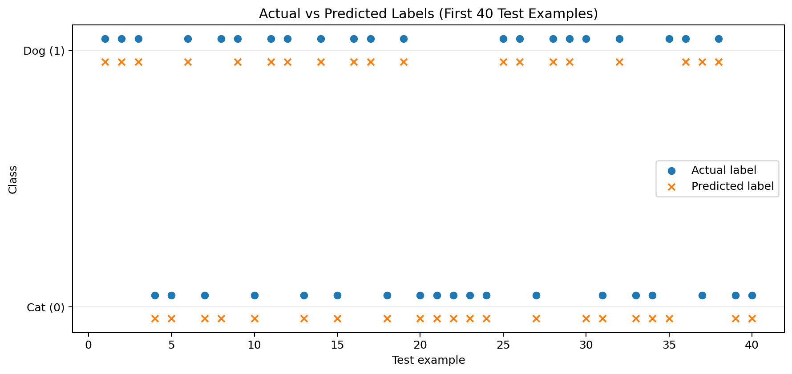
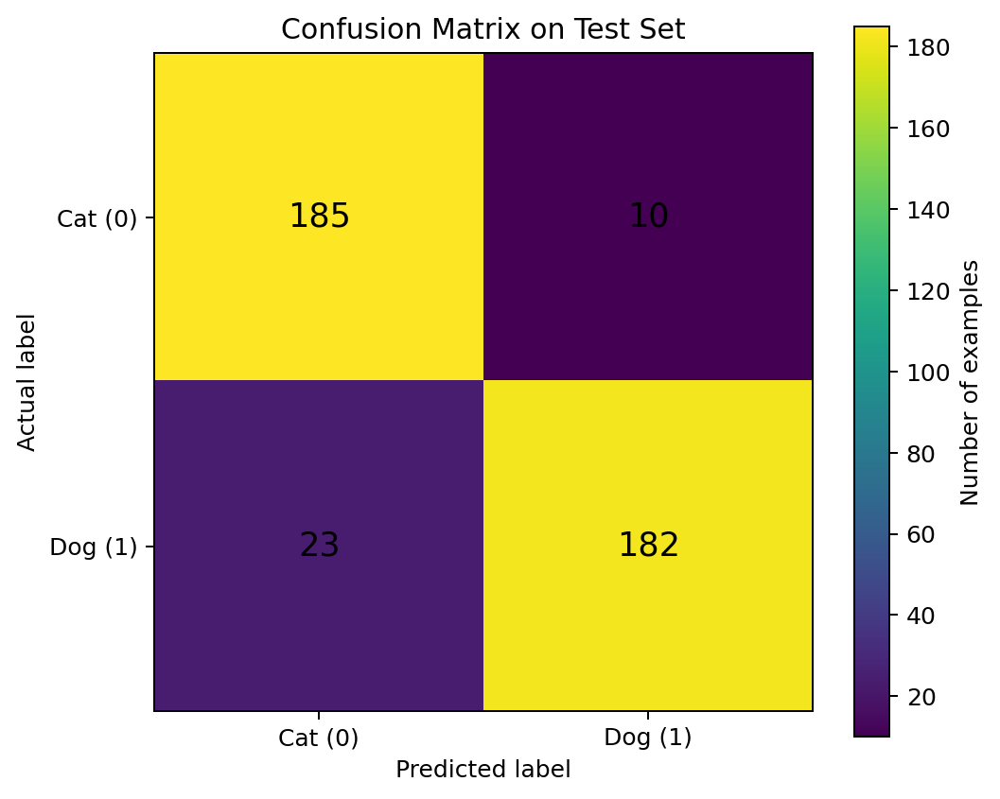

# Cat vs. Dog Classification with PyTorch

A beginner machine-learning project that trains a small neural network to classify an animal as a **cat (0)** or **dog (1)** using five numerical features.

> **Important:** The dataset is synthetic and created for learning. The model demonstrates a machine-learning workflow; it is not intended for real-world animal identification.

## Project goals

- Build a neural network with PyTorch instead of relying on a high-level model API.
- Learn the training loop: forward pass, loss calculation, backpropagation, and optimizer update.
- Evaluate predictions on a held-out test set.
- Use visualizations to understand training progress and classification errors.

## Dataset

The CSV contains **2,000 rows** and five input features:

| Feature | Description |
|---|---|
| `weight_kg` | Animal weight in kilograms |
| `height_cm` | Animal height in centimetres |
| `body_length_cm` | Body length in centimetres |
| `ear_length_cm` | Ear length in centimetres |
| `leg_length_cm` | Leg length in centimetres |
| `output` | Target label: `0` = cat, `1` = dog |

The dataset is split into **80% training data** and **20% test data**. The test set is held out during training so the model can be evaluated on examples it did not train on.

## Model architecture

The network is a compact feed-forward neural network:

1. **Input layer:** 5 numerical features.
2. **Hidden layer:** 8 neurons with a ReLU activation function.
3. **Output layer:** 2 logits, one for each class.

The model is trained with **Cross-Entropy Loss** and the **Adam optimizer** using a learning rate of `0.01` for 100 epochs. The class prediction is selected from the output logits using the highest-scoring class.

## Results

- **Test accuracy:** 91.75%
- **Training examples:** 1,600
- **Test examples:** 400

Accuracy is a useful summary, but it does not show which class the model struggles with. The graphs below provide additional context.

## Visual results

### 1. Training loss



This graph shows the model's training loss after each epoch. Loss measures how far the model's output scores are from the correct labels; lower is generally better. A downward trend suggests the model is learning patterns in the training data. The curve alone does **not** prove that the model generalizes well, which is why a separate test set is used.

### 2. Actual vs. predicted labels



Each position represents one of the first 40 test examples. The vertical axis shows the class: cat (`0`) or dog (`1`). Circles mark the true labels and crosses mark the model's predictions. When the two markers for an example align at the same class, the prediction is correct. When they appear at different classes, the model misclassified that example. This plot makes individual prediction mistakes easier to spot.

### 3. Confusion matrix



The confusion matrix summarizes predictions across the entire test set. Rows represent the actual class and columns represent the predicted class. The diagonal cells are correct predictions; the off-diagonal cells are mistakes. This helps distinguish cats predicted as dogs from dogs predicted as cats, rather than relying on accuracy alone.

## How to run

Install the dependencies:

```bash
pip install torch pandas scikit-learn matplotlib
```

Place `cat_dog_numerical_dataset.csv` in the project folder, then run your training script.

The graph images are separate files referenced by this README. They do not need to be embedded in the Python training code. If you retrain the model or change the dataset, regenerate the graphs so the README's visualizations and reported accuracy match the new run.

## Skills demonstrated

- Python and PyTorch
- Neural-network architecture design
- Supervised classification
- Train/test splitting
- Loss functions and gradient-based optimization
- Model evaluation and error analysis
- Data visualization and technical documentation

## Limitations and next steps

- The dataset is synthetic, so performance on it should not be interpreted as real-world accuracy.
- The current workflow does not normalize input features.
- A useful next iteration would compare training and validation loss, normalize features using statistics calculated from the training set, and evaluate precision, recall, and F1-score for each class.
- Testing on a realistic, independently collected dataset would be necessary before making real-world claims.
